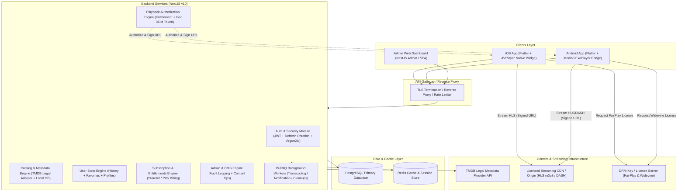
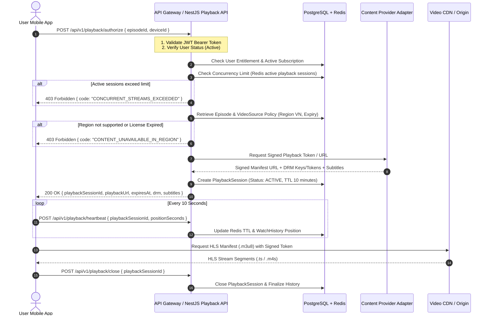

# CINEORA System Architecture & Technical Specification

> **Platform:** CINEORA - Professional Movie & TV Streaming Platform  
> **Target OS:** iOS & Android (Unified Flutter Engine)  
> **Backend:** NestJS + TypeScript + PostgreSQL + Prisma + Redis + BullMQ  
> **Brand Identity:** Dark Cinema Theme | "Your Cinema. Everywhere."  
> **Compliance:** 100% Licensed & Legal Content Provider Adapter Architecture  

---

## 1. High-Level Architecture Overview

CINEORA is designed following clean architecture, domain-driven boundaries, and enterprise streaming principles. It separates client rendering, authentication/entitlement, metadata discovery, content delivery, and media telemetry.



---

## 2. Core Subsystems

### 2.1. Mobile Application (Flutter Multiplatform)
- **Framework:** Flutter 3.x with Dart 3.x.
- **State Management:** Riverpod (`flutter_riverpod`) providing unidirectional data flow and testability.
- **Navigation:** `go_router` with declarative deep linking and guard middleware (AuthGuard, SubscriptionGuard).
- **Networking:** `dio` configured with interceptors for token auto-refresh, retry backoff, circuit-breaker logging, and connectivity monitoring (`connectivity_plus`).
- **Storage:**
  - `flutter_secure_storage`: Encrypted storage for JWT access/refresh tokens and user session keys.
  - `shared_preferences` / `hive` / `sqflite`: Local cache for search history, offline bookmarks, and playback position snapshots.
- **Video Player Core:**
  - Standardized interface `CineoraPlayerController` abstracting the platform-specific native media engines:
    - **iOS:** AVPlayer through AVKit with FairPlay DRM support and native Picture-in-Picture.
    - **Android:** AndroidX Media3 (ExoPlayer) with Widevine Modular DRM, multi-audio selection, and WebVTT subtitle track rendering.
  - Adaptive Bitrate (ABR) algorithm supporting 360p, 480p, 720p, 1080p, and Auto.
  - Periodic heartbeat telemetry (every 10s) to keep active sessions alive and record precise watch progress.

### 2.2. Backend Application (NestJS Modular Monolith)
- **Architecture:** NestJS v10 with TypeScript in strict mode.
- **Modular Domains:**
  - `AuthModule`: Registration, login, password recovery, refresh token rotation, session invalidation.
  - `UsersModule`: Profiles, avatar updates, account deletion (GDPR/Apple App Store compliance).
  - `MoviesModule`: Movie catalog, categorization, filtering, search indexing, rating aggregations.
  - `EpisodesModule`: Seasons and episode metadata, stills, durations, air dates.
  - `ProvidersModule`: Provider Adapter Pattern allowing seamless integration of licensed video sources (Public Domain Archives, Licensed CDN, FairPlay/Widevine token generators).
  - `PlaybackModule`: Security gateway verifying user entitlements, geographic location (Vietnam region policy), subscription validity, active stream concurrency (max 1 for Free, 2-4 for Premium), and issuing signed playback URLs.
  - `WatchHistoryModule`: Syncing playback positions, calculating completion percentage (>90% marks completed).
  - `FavoritesModule`: Personal user watchlist management.
  - `SubscriptionsModule`: Package management (Free, Premium Monthly, Premium Yearly), receipt validation hooks.
  - `AdminModule`: Role-Based Access Control (Super Admin, Content Manager, Support), audit log trails, content publishing controls.
  - `HealthModule`: Terminus health checks for database, Redis, and memory usage.

### 2.3. Licensed Content Provider Architecture (Provider Adapter Pattern)
The platform strictly rejects unauthorized web scrapers. All video delivery operates through the `IContentProviderAdapter` interface:

```typescript
export interface PlaybackAuthorizationRequest {
  userId: string;
  movieId: string;
  episodeId: string;
  userIp: string;
  userCountry: string;
  subscriptionTier: 'FREE' | 'PREMIUM';
  deviceId: string;
}

export interface PlaybackAuthorizationResult {
  authorized: boolean;
  denialReason?: string;
  playbackSessionId: string;
  playbackUrl: string;       // Signed, time-limited HLS/DASH manifest URL
  expiresAt: Date;
  drm?: {
    type: 'WIDEVINE' | 'FAIRPLAY' | 'CLEARKEY' | 'NONE';
    licenseServerUrl?: string;
    certificateUrl?: string;
    drmToken?: string;
  };
  subtitles: {
    language: string;
    label: string;
    format: 'VTT' | 'SRT';
    url: string;
    isDefault: boolean;
  }[];
  audioTracks: {
    language: string;
    label: string;
    isDefault: boolean;
  }[];
}

export interface IContentProviderAdapter {
  readonly providerId: string;
  readonly providerName: string;
  authorizePlayback(request: PlaybackAuthorizationRequest): Promise<PlaybackAuthorizationResult>;
  validateHealth(): Promise<boolean>;
}
```

---

## 3. Playback Authorization Sequence



---

## 4. Security & Compliance Matrix

| Vector | Strategy | Implementation |
|---|---|---|
| **Authentication** | Dual-Token Flow | Short-lived Access Token (15m JWT) + Long-lived Refresh Token (30d stored as SHA-256 hash in DB with rotation) |
| **Passwords** | High-entropy Hashing | Argon2id with custom memory & iteration parameters |
| **Tamper Resistance** | Signed Stream URLs | HMAC-SHA256 time-limited tokens (expire in 2 hours or on session end) |
| **Concurrency Control**| Distributed Lock | Redis keys `session:user:{userId}` tracking active player leases |
| **Data Protection** | Secure Storage | iOS Keychain via `flutter_secure_storage`, Android Keystore via EncryptedSharedPreferences |
| **App Store Compliance**| In-App Purchase & Deletion | Full Apple Account Deletion endpoint (`POST /api/v1/auth/delete-account`), Apple & Google Billing integration hooks |
| **Rate Limiting** | Throttling | `@nestjs/throttler` with Redis backing: 100 req/min for general API, 5 req/min for auth endpoints |

---

## 5. Deployment & Scalability Architecture

- **Containerization:** Multi-stage Dockerfile for NestJS backend reducing image footprint to minimal alpine node runtime.
- **Orchestration:** `docker-compose.yml` for local development & staging (NestJS, PostgreSQL 16, Redis 7).
- **Production Readiness:** Configurable via Environment variables (`.env.production`), automated database migrations via Prisma CLI, structured JSON logging with Pino, and Prometheus metrics endpoint.
