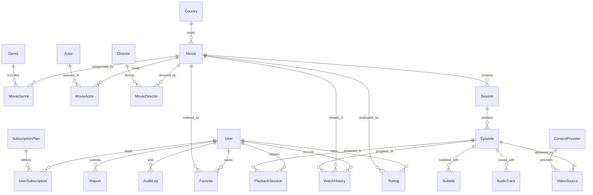

# CINEORA Database Architecture & Schema Specification

> **Database Engine:** PostgreSQL 15+  
> **ORM:** Prisma 5.x / 6.x  
> **Cache & Session:** Redis 7.x  
> **Target Schema:** Relational, Normal Form 3NF, B-tree indexes, Composite Unique constraints, Foreign Key cascades.

---

## 1. Entity Relationship Diagram (ERD)

---

## 2. Table Definitions & Constraints

### 2.1. `users`
| Column | Type | Constraints | Description |
|---|---|---|---|
| `id` | UUID | PRIMARY KEY, DEFAULT uuid_generate_v4() | Unique User identifier |
| `email` | VARCHAR(255) | NOT NULL, UNIQUE, INDEX | Normalized lowercase email |
| `password_hash` | VARCHAR(255) | NOT NULL | Argon2id hash |
| `display_name` | VARCHAR(100) | NOT NULL | User's full or screen name |
| `avatar_url` | TEXT | NULL | Profile image link |
| `role` | VARCHAR(30) | NOT NULL, DEFAULT 'USER' | Enum: USER, SUPPORT, CONTENT_MANAGER, SUPER_ADMIN |
| `status` | VARCHAR(30) | NOT NULL, DEFAULT 'ACTIVE' | Enum: ACTIVE, SUSPENDED, PENDING_VERIFICATION, DELETED |
| `refresh_token_hash`| TEXT | NULL | SHA-256 hash of active refresh token |
| `created_at` | TIMESTAMPTZ | NOT NULL, DEFAULT NOW() | Timestamp |
| `updated_at` | TIMESTAMPTZ | NOT NULL, DEFAULT NOW() | Timestamp |

### 2.2. `countries`
| Column | Type | Constraints | Description |
|---|---|---|---|
| `id` | VARCHAR(10) | PRIMARY KEY | ISO 3166-1 alpha-2 code (e.g., 'VN', 'KR', 'US') |
| `name` | VARCHAR(100) | NOT NULL | Country name (e.g., 'Việt Nam', 'Hàn Quốc') |

### 2.3. `genres`
| Column | Type | Constraints | Description |
|---|---|---|---|
| `id` | UUID | PRIMARY KEY, DEFAULT gen_random_uuid() | Genre ID |
| `name` | VARCHAR(100) | NOT NULL | Display name (e.g., 'Hành Động') |
| `slug` | VARCHAR(100) | NOT NULL, UNIQUE, INDEX | URL slug (e.g., 'hanh-dong') |

### 2.4. `movies`
| Column | Type | Constraints | Description |
|---|---|---|---|
| `id` | UUID | PRIMARY KEY, DEFAULT gen_random_uuid() | Unique movie ID |
| `title` | VARCHAR(255) | NOT NULL, INDEX | Primary title in Vietnamese |
| `original_title` | VARCHAR(255) | NOT NULL, INDEX | Original language title |
| `slug` | VARCHAR(255) | NOT NULL, UNIQUE, INDEX | URL friendly slug |
| `description` | TEXT | NOT NULL | Synopsis / summary |
| `poster_url` | TEXT | NOT NULL | Vertical poster (2:3 aspect ratio) |
| `backdrop_url` | TEXT | NOT NULL | Horizontal backdrop (16:9 aspect ratio) |
| `release_year` | INT | NOT NULL, INDEX | Year of release |
| `duration` | INT | NOT NULL | Duration in minutes (0 for series) |
| `type` | VARCHAR(20) | NOT NULL, DEFAULT 'MOVIE' | 'MOVIE' (Phim lẻ) or 'SERIES' (Phim bộ) |
| `country_id` | VARCHAR(10) | REFERENCES countries(id), INDEX | Country of origin |
| `status` | VARCHAR(30) | NOT NULL, DEFAULT 'PUBLISHED' | DRAFT, PUBLISHED, ARCHIVED |
| `rating_average` | NUMERIC(3, 1)| DEFAULT 0.0, INDEX | Aggregated rating 0.0 - 10.0 |
| `rating_count` | INT | DEFAULT 0 | Total number of user ratings |
| `view_count` | BIGINT | DEFAULT 0, INDEX | Total completed views |
| `metadata_provider` | VARCHAR(50)| DEFAULT 'TMDB' | Provider of metadata |
| `metadata_external_id`| VARCHAR(100)| INDEX | External ID from provider |
| `trailer_url` | TEXT | NULL | Official YouTube/HLS trailer link |
| `created_at` | TIMESTAMPTZ | NOT NULL, DEFAULT NOW() | Creation time |
| `updated_at` | TIMESTAMPTZ | NOT NULL, DEFAULT NOW() | Update time |

### 2.5. `movie_genres`
- `movie_id` UUID REFERENCES movies(id) ON DELETE CASCADE
- `genre_id` UUID REFERENCES genres(id) ON DELETE CASCADE
- PRIMARY KEY (`movie_id`, `genre_id`)

### 2.6. `actors` & `movie_actors`
- `actors`: `id` UUID, `name` VARCHAR(150), `avatar_url` TEXT
- `movie_actors`: `movie_id` UUID, `actor_id` UUID, `character_name` VARCHAR(150)
- PRIMARY KEY (`movie_id`, `actor_id`)

### 2.7. `directors` & `movie_directors`
- `directors`: `id` UUID, `name` VARCHAR(150), `avatar_url` TEXT
- `movie_directors`: `movie_id` UUID, `director_id` UUID
- PRIMARY KEY (`movie_id`, `director_id`)

### 2.8. `seasons` & `episodes`
- `seasons`:
  - `id` UUID PRIMARY KEY
  - `movie_id` UUID REFERENCES movies(id) ON DELETE CASCADE
  - `season_number` INT NOT NULL
  - `title` VARCHAR(150) NOT NULL
  - `overview` TEXT NULL
  - UNIQUE(`movie_id`, `season_number`)
- `episodes`:
  - `id` UUID PRIMARY KEY
  - `season_id` UUID REFERENCES seasons(id) ON DELETE CASCADE
  - `episode_number` INT NOT NULL
  - `title` VARCHAR(200) NOT NULL
  - `duration` INT NOT NULL (duration in seconds)
  - `overview` TEXT NULL
  - `still_url` TEXT NULL (16:9 thumbnail)
  - `status` VARCHAR(30) DEFAULT 'ACTIVE'
  - UNIQUE(`season_id`, `episode_number`)

### 2.9. `content_providers` & `video_sources`
- `content_providers`:
  - `id` VARCHAR(50) PRIMARY KEY (e.g., 'PUBLIC_DOMAIN_ARCHIVE', 'CINEORA_ORIGIN_CDN', 'LICENSED_PARTNER_A')
  - `name` VARCHAR(150) NOT NULL
  - `provider_type` VARCHAR(50) NOT NULL (e.g., 'HLS_STREAM', 'DASH_DRM', 'S3_SIGNED')
  - `api_endpoint` TEXT NULL
  - `status` VARCHAR(30) DEFAULT 'ACTIVE'
  - `created_at` TIMESTAMPTZ DEFAULT NOW()
- `video_sources`:
  - `id` UUID PRIMARY KEY
  - `episode_id` UUID REFERENCES episodes(id) ON DELETE CASCADE
  - `provider_id` VARCHAR(50) REFERENCES content_providers(id)
  - `external_content_id` VARCHAR(255) NOT NULL
  - `playback_url` TEXT NOT NULL (HLS .m3u8 or DASH .mpd)
  - `drm_type` VARCHAR(30) DEFAULT 'NONE' (NONE, WIDEVINE, FAIRPLAY, CLEARKEY)
  - `license_url` TEXT NULL
  - `certificate_url` TEXT NULL
  - `region_policy` VARCHAR(50) DEFAULT 'VN_ONLY' (VN_ONLY, GLOBAL, RESTRICTED)
  - `resolution` VARCHAR(20) DEFAULT '1080p'
  - `availability_start` TIMESTAMPTZ NOT NULL
  - `availability_end` TIMESTAMPTZ NOT NULL
  - `status` VARCHAR(30) DEFAULT 'ACTIVE'
  - INDEX(`episode_id`, `status`)

### 2.10. `subtitles` & `audio_tracks`
- `subtitles`:
  - `id` UUID PRIMARY KEY
  - `episode_id` UUID REFERENCES episodes(id) ON DELETE CASCADE
  - `language` VARCHAR(10) NOT NULL (e.g., 'vi', 'en')
  - `label` VARCHAR(50) NOT NULL (e.g., 'Tiếng Việt', 'English')
  - `format` VARCHAR(10) NOT NULL DEFAULT 'VTT' (VTT, SRT)
  - `url` TEXT NOT NULL
  - `is_default` BOOLEAN DEFAULT false
- `audio_tracks`:
  - `id` UUID PRIMARY KEY
  - `episode_id` UUID REFERENCES episodes(id) ON DELETE CASCADE
  - `language` VARCHAR(10) NOT NULL
  - `label` VARCHAR(50) NOT NULL (e.g., 'Gốc (Tiếng Hàn)', 'Thuyết minh Tiếng Việt')
  - `is_default` BOOLEAN DEFAULT false

### 2.11. `watch_history`
- `id` UUID PRIMARY KEY
- `user_id` UUID REFERENCES users(id) ON DELETE CASCADE
- `movie_id` UUID REFERENCES movies(id) ON DELETE CASCADE
- `episode_id` UUID REFERENCES episodes(id) ON DELETE CASCADE
- `position_seconds` INT NOT NULL DEFAULT 0
- `duration_seconds` INT NOT NULL DEFAULT 0
- `is_completed` BOOLEAN NOT NULL DEFAULT false
- `updated_at` TIMESTAMPTZ NOT NULL DEFAULT NOW()
- UNIQUE(`user_id`, `episode_id`)
- INDEX(`user_id`, `updated_at` DESC)

### 2.12. `favorites` & `ratings`
- `favorites`:
  - `id` UUID PRIMARY KEY
  - `user_id` UUID REFERENCES users(id) ON DELETE CASCADE
  - `movie_id` UUID REFERENCES movies(id) ON DELETE CASCADE
  - `created_at` TIMESTAMPTZ NOT NULL DEFAULT NOW()
  - UNIQUE(`user_id`, `movie_id`)
- `ratings`:
  - `id` UUID PRIMARY KEY
  - `user_id` UUID REFERENCES users(id) ON DELETE CASCADE
  - `movie_id` UUID REFERENCES movies(id) ON DELETE CASCADE
  - `score` NUMERIC(2, 1) NOT NULL (1.0 to 10.0)
  - `review` TEXT NULL
  - `created_at` TIMESTAMPTZ NOT NULL DEFAULT NOW()
  - UNIQUE(`user_id`, `movie_id`)

### 2.13. `subscription_plans` & `user_subscriptions`
- `subscription_plans`:
  - `id` VARCHAR(50) PRIMARY KEY (e.g., 'PLAN_FREE', 'PLAN_PREMIUM_MONTHLY', 'PLAN_PREMIUM_YEARLY')
  - `name` VARCHAR(100) NOT NULL
  - `price` NUMERIC(12, 2) NOT NULL DEFAULT 0
  - `currency` VARCHAR(10) NOT NULL DEFAULT 'VND'
  - `duration_days` INT NOT NULL (30, 365, 0 for unlimited free)
  - `max_streams` INT NOT NULL DEFAULT 1
  - `max_resolution` VARCHAR(20) NOT NULL DEFAULT '1080p'
  - `status` VARCHAR(30) DEFAULT 'ACTIVE'
- `user_subscriptions`:
  - `id` UUID PRIMARY KEY
  - `user_id` UUID REFERENCES users(id) ON DELETE CASCADE
  - `plan_id` VARCHAR(50) REFERENCES subscription_plans(id)
  - `starts_at` TIMESTAMPTZ NOT NULL
  - `expires_at` TIMESTAMPTZ NOT NULL
  - `status` VARCHAR(30) DEFAULT 'ACTIVE' (ACTIVE, EXPIRED, CANCELLED)
  - `payment_reference` VARCHAR(255) NULL
  - INDEX(`user_id`, `status`, `expires_at`)

### 2.14. `playback_sessions`
- `id` UUID PRIMARY KEY
- `user_id` UUID REFERENCES users(id) ON DELETE CASCADE
- `episode_id` UUID REFERENCES episodes(id) ON DELETE CASCADE
- `provider_id` VARCHAR(50) REFERENCES content_providers(id)
- `device_id` VARCHAR(255) NOT NULL
- `ip_address` VARCHAR(45) NOT NULL
- `session_status` VARCHAR(30) DEFAULT 'ACTIVE' (ACTIVE, PAUSED, TERMINATED, EXPIRED)
- `started_at` TIMESTAMPTZ NOT NULL DEFAULT NOW()
- `last_heartbeat` TIMESTAMPTZ NOT NULL DEFAULT NOW()
- `ended_at` TIMESTAMPTZ NULL
- INDEX(`user_id`, `session_status`)

### 2.15. `reports` & `audit_logs`
- `reports`:
  - `id` UUID PRIMARY KEY
  - `user_id` UUID REFERENCES users(id) ON DELETE SET NULL
  - `movie_id` UUID REFERENCES movies(id) ON DELETE CASCADE
  - `episode_id` UUID REFERENCES episodes(id) ON DELETE SET NULL
  - `reason` VARCHAR(100) NOT NULL (e.g., 'VIDEO_ERROR', 'SUBTITLE_MISMATCH', 'AUDIO_DESYNC')
  - `details` TEXT NULL
  - `status` VARCHAR(30) DEFAULT 'PENDING'
  - `created_at` TIMESTAMPTZ DEFAULT NOW()
- `audit_logs`:
  - `id` UUID PRIMARY KEY
  - `admin_id` UUID REFERENCES users(id) ON DELETE SET NULL
  - `action` VARCHAR(100) NOT NULL
  - `entity` VARCHAR(100) NOT NULL
  - `entity_id` VARCHAR(100) NOT NULL
  - `changes` JSONB NULL
  - `ip_address` VARCHAR(45) NULL
  - `created_at` TIMESTAMPTZ DEFAULT NOW()
